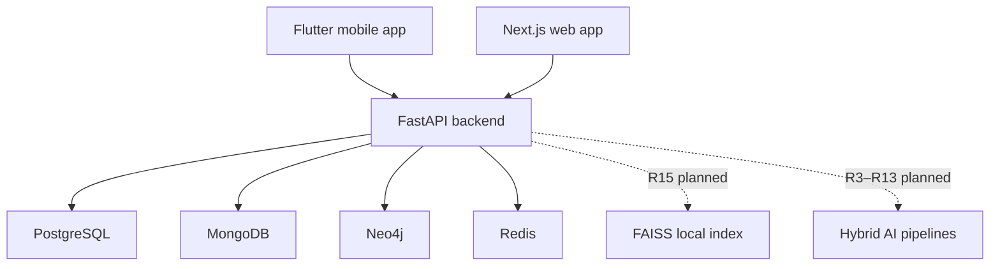

# System Architecture

NutriLens X has exactly 15 frozen modules. R0 establishes integration boundaries; later AI and data components shown below are planned, not complete.

The root directory currently hosts the working web application to preserve existing imports. `apps/web` records its logical monorepo location; `apps/mobile` contains the Flutter foundation. The API owns connectivity and exposes explicit health state. Databases use named local Docker volumes.
